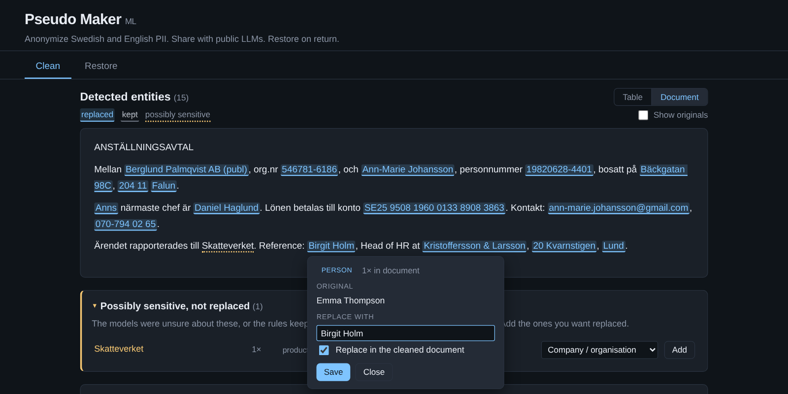

# Pseudo Maker ML

**Use public LLMs on sensitive Swedish documents without sending them any personal data.**

Pseudo Maker replaces every personal or identifying detail in a document with a realistic fake, and keeps a local key. You work with ChatGPT, Claude or another LLM on the cleaned version, then put the LLM's answer back through the tool to swap the real values back in. Your files and the key never leave your machine.

It is built for Swedish documents: contracts, case files, HR documents, CVs. It also handles English and mixed Swedish/English text.



```
Original   Anna-Karin Lindqvist (19850312-2387) anställs av Nordström Bygg AB (publ), org.nr 556677-8899.
           Annas chef är Per Åkesson. Hon bor på Storgatan 12B, 211 34 Malmö.

Cleaned    Ann-Marie Söderström (19830920-0387) anställs av Berglund Palmqvist AB (publ), org.nr 543525-5343.
           Anns chef är Daniel Haglund. Hon bor på Backvägen 71C, 333 98 Mölndal.
```

The fakes are realistic, so the LLM's answer stays natural and easy to map back:
- Personnummer and orgnr pass their checksums. Personnummer keep gender and roughly the same age.
- Names keep their gender (*hon/han* still fits), hyphenation and genitive (`Annas` → `Anns`).
- The same person always gets the same fake throughout the document.

## What's in it

- **Web UI and CLI.** Upload a `.docx`, `.txt` or `.md` file and review every detection, either in a table or in the document itself with each substitution highlighted. Untick or edit any fake, add findings the tool was unsure about, or add your own terms. Then download the cleaned file and its mapping (the key). Word formatting (bold, tables, headers) is preserved.
- **Restore with audit log.** Restore puts the originals back into the LLM's reply, including forms the LLM invents, such as genitives (`Söderströms` → `Lindqvists`) and bare first names. It writes an audit log of every substitution.
- **Models first, rules as fallback.**
  - Two NER models find names, companies and places: [KB-BERT](https://huggingface.co/KBLab/bert-base-swedish-cased-ner) from the National Library of Sweden for Swedish, and [Rampart](https://github.com/nationaldesignstudio/rampart) for English. See [The models and why](#the-models-and-why).
  - Checksum-validated rules catch structured identifiers: personnummer, samordningsnummer, orgnr, IBAN, bankgiro, plusgiro, VAT, card numbers, phone numbers, emails, license plates, case numbers.
  - Further rules handle the edge cases the models miss.
- **Local and offline.** Both models run on CPU via ONNX (~140 MB in total). Nothing is sent anywhere at runtime.

## The models and why

No single model does the job well. Swedish and English need different models, and structured identifiers like personnummer are better handled by exact rules than by any model. So detection is layered: each layer covers what the others are weak at.

### KB-BERT — Swedish names, companies and places

**[`KBLab/bert-base-swedish-cased-ner`](https://huggingface.co/KBLab/bert-base-swedish-cased-ner)** · base model [`KBLab/bert-base-swedish-cased`](https://huggingface.co/KBLab/bert-base-swedish-cased) · [GitHub](https://github.com/Kungbib/swedish-bert-models) · [paper](https://arxiv.org/abs/2007.01658) · MIT (base CC0)

A BERT model trained by [KBLab](https://kb.se/), the data lab at the National Library of Sweden, on about 3 billion words of Swedish text. It's fine-tuned for named entities on the [SUC 3.0](https://spraakbanken.gu.se/en/resources/suc3) corpus (F1 0.92).

**Why:** it's the strongest openly licensed Swedish NER model, and it was trained on real Swedish: newspapers, government documents, books. Its vocabulary is cased and keeps å/ä/ö, so `Åkesson`, `Anna-Karin` or `Västerås` stay intact. Results on the held-out set:
- Swedish names, companies and places fully replaced: 90% with spaCy → **100%** with KB-BERT.
- It also catches what spaCy missed: ALL-CAPS names (via a title-case trick), bare surnames ("*Ek noterade …*") and genitives (`Per Åkessons`).

**How it's used:** `pseudo-maker fetch-models` exports it once to int8 ONNX (125 MB, 98.6% token agreement with the original). It runs on every paragraph.

### Rampart — English and other Latin-script PII

**[`nationaldesignstudio/rampart`](https://github.com/nationaldesignstudio/rampart)** · [model card](https://huggingface.co/nationaldesignstudio/rampart) · base model [`MiniLM-L6-H384`](https://huggingface.co/nreimers/MiniLM-L6-H384-uncased) · trained on [OpenPII 1.5M](https://huggingface.co/datasets/ai4privacy/pii-masking-openpii-1.5m) · CC BY 4.0

A small (15 MB) PII detector from National Design Studio. It's trained on 1.5 million examples in seven languages: English, Spanish, French, German, Italian, Portuguese and Dutch. It labels given names, surnames, street names, building numbers, cities, phone numbers and ID numbers.

**Why:** Swedish documents often contain English: CVs, references, international contacts. Both Swedish models (spaCy and KB-BERT) are weak on English names and addresses. Rampart raised English recall from 68% to **91%** on the held-out set, at about 40 ms per paragraph.

**Caveats:** it lowercases text, strips accents and has no company label. So it only runs on paragraphs that look English, and its name hits must be capitalised in the original.

### spaCy `sv_core_news_lg` — optional fallback

**[`sv_core_news_lg`](https://spacy.io/models/sv#sv_core_news_lg)** · [Hugging Face](https://huggingface.co/spacy/sv_core_news_lg) · CC BY-SA 4.0

The model the original pseudo-maker used. Here it's optional (550 MB):
- It replaces KB-BERT when the KB model isn't installed.
- When installed, it also reads English paragraphs, where it catches company names Rampart has no label for. This adds about 6 points of English recall.

### Rules — the hard-coded fallback

Models are statistical and can miss things; some identifiers must never be missed. The rules layer always runs, and checksum-validated matches always win over model output:

- **Checksum and format rules:** personnummer, samordningsnummer, orgnr, IBAN, bankgiro, plusgiro, VAT, card numbers, phones, emails, plates, case numbers.
- **Patterns:** `AB`/`HB`/`Ltd`/`GmbH` company names, streets with house numbers, lists of well-known Swedish and international companies and places.
- **Filters** shared by every model: countries, public agencies, products like Teams/Excel, titles, weekdays and job titles are left alone.
- **Post-passes:** a name found once is found everywhere, plus genitive and alias linking.

### Fakes — not a model

Replacements come from [Faker's `sv_SE` locale](https://faker.readthedocs.io/en/master/locales/sv_SE.html) plus custom generators. The custom ones produce checksum-valid personnummer, orgnr, IBAN and bankgiro, and names that keep gender and shape.

All models run locally on CPU via [ONNX Runtime](https://onnxruntime.ai/). No PyTorch is needed at runtime, and nothing is sent anywhere. Attribution is in [`NOTICE`](NOTICE).

## Quick start

```sh
git clone https://github.com/121Development/pseudo-maker-ml && cd pseudo-maker-ml
python -m venv .venv && source .venv/bin/activate
pip install --index-url https://download.pytorch.org/whl/cpu torch   # only needed to build the KB-BERT model
pip install -e ".[export,spacy]"
python -m spacy download sv_core_news_lg                            # optional fallback model
pseudo-maker fetch-models                                           # download Rampart, build KB-BERT (~2 min)
pseudo-maker serve                                                  # opens http://127.0.0.1:8765
```

Docker and a single-file binary are described under [Getting started](#getting-started).

## How it differs from pseudo-maker

[pseudo-maker](https://github.com/121Development/pseudo-maker) uses spaCy's Swedish model plus rules. This ML variant puts KB-BERT and Rampart in front and keeps spaCy only as an optional fallback. On a held-out test set, the share of names, companies and places fully replaced goes from 83% to 95.5% (Swedish 90% → 100%, English 74% → 91%). The cost is slower detection, about 70 ms per paragraph on CPU. Details are under [Evaluation](#detection-models-first-rules-as-fallback).

## Workflow

```
┌──────────────────┐      ┌──────────────────┐      ┌──────────────────┐
│ your_doc.docx    │──▶──▶│ your_doc_        │──▶──▶│  Public LLM      │
│   (sensitive)    │ clean│   CLEANED.docx   │ copy │  (ChatGPT, etc.) │
└──────────────────┘      │ your_doc_        │      └───────┬──────────┘
                          │   MAPPING.json   │              │ LLM reply
                          └──────────────────┘              ▼
┌──────────────────┐      ┌──────────────────┐      ┌──────────────────┐
│ your_doc_        │◀──◀──│ your_doc_        │◀──◀──│  llm_reply.docx  │
│   RESTORED.docx  │ rest.│   AUDIT.json     │      │                  │
│ your_doc_        │      └──────────────────┘      └──────────────────┘
│   AUDIT.json     │
└──────────────────┘
```

The mapping file contains your real sensitive values — **keep it local**. The cleaned file is safe to share with an LLM because every identifier has been replaced with a realistic fake.

## What it detects

| Category | Examples |
|---|---|
| Personal | Person names, Swedish personnummer (Luhn-validated), phone, email, home address |
| Organisations | Company names, Swedish organisationsnummer (Luhn), VAT |
| Financial | IBAN, bankgiro, plusgiro, credit card |
| Geographic | Swedish cities and streets (kept separately), postal codes |
| Other identifiers | Swedish license plates, passport numbers, case/diary numbers (`Dnr`, `Mål nr`), other ID numbers (tax ID, driver's licence, account numbers), IP addresses, URLs |
| Quasi-identifiers | Dates, ages |

Left as-is on purpose: countries, public agencies (`Skatteverket`, `Försäkringskassan`), products and tools (`Teams`, `Excel`), job titles, weekdays.

### Detection: models first, rules as fallback

```
paragraph ─┬─▶ KB-BERT Swedish NER (ONNX, int8)   persons, companies, places   ── always
           ├─▶ Rampart (ONNX, q4)                 English names, addresses     ── English-looking paragraphs
           ├─▶ spaCy sv_core_news_lg (optional)   assists on English; replaces KB-BERT if it isn't installed
           └─▶ rules (always on)                  checksum IDs, AB/Ltd company patterns, streets + house numbers,
                                                  case numbers, known Swedish/international companies and places
                         │
                         ▼
     merge overlaps (checksum IDs always win; models and name patterns: longer span wins)
     → shared filters (blocklists, titles, agencies, job titles, countries)
     → document-wide name propagation, genitives, aliases
```

| Model | What it's for | Size | License |
|---|---|---|---|
| [`KBLab/bert-base-swedish-cased-ner`](https://huggingface.co/KBLab/bert-base-swedish-cased-ner) | Swedish persons / organisations / locations (SUC 3.0, F1 0.92) | 125 MB (int8 ONNX, exported locally) | MIT (base: CC0) |
| [`nationaldesignstudio/rampart`](https://github.com/nationaldesignstudio/rampart) | English / Latin-script PII: names, streets, cities, IDs | 15 MB (q4 ONNX) | CC BY 4.0 |
| `sv_core_news_lg` (optional) | Fallback when KB-BERT isn't installed; extra recall on English company names | 550 MB | CC BY-SA 4.0 |

Both models run on CPU with `onnxruntime`. There's no PyTorch at runtime and no network access: models are only downloaded by `pseudo-maker fetch-models`. See [`NOTICE`](NOTICE) for attribution.

**Evaluation** (`python scripts/eval_ner.py`; *leak-free recall* = share of names/companies/places with every character replaced):

| Setup | Held-out set: sv | en | mix | all | precision | ms / paragraph |
|---|---|---|---|---|---|---|
| spaCy + rules (original pseudo-maker) | 90.0% | 73.5% | 85.7% | 83.0% | 98.8% | 6 |
| KB-BERT + rules | **100%** | 67.6% | 85.7% | 85.2% | 98.7% | 17 |
| **KB-BERT + Rampart + rules (default)** | **100%** | **91.2%** | **92.9%** | **95.5%** | 98.8% | 72 |

`tests/data/ner_heldout.jsonl` (40 passages, 88 entities) was written after the rules were tuned and never used for tuning. On the tuning set (`ner_gold.jsonl`, 87 passages) the default setup reaches 98.9%. Remaining misses are mostly English company names that none of the models know, e.g. "Pinewood Analytics".

Selecting models:

| Setting | CLI | Environment (web UI / Docker) | Values |
|---|---|---|---|
| Swedish NER | `--ner` | `PSEUDO_MAKER_NER` | `auto` (KB-BERT, else spaCy, else rules only) · `kb` · `spacy` · `off` |
| English NER | `--english-ner` | `PSEUDO_MAKER_ENGLISH_NER` | `auto` (English-looking paragraphs) · `on` (all) · `off` |
| Model location | `fetch-models --dest` | `PSEUDO_MAKER_MODELS_DIR` | default `~/.cache/pseudo-maker/models` |

The **rules** use regex + checksum validators for deterministic formats (personnummer, orgnr, IBAN, credit card, …). They skip `ISO 27001`-style standard numbers, country names, role words (`OWNER/FOUNDER`), and a built-in blocklist of common false positives (`site`, `turnover`, `Java` the language, `Teams`, `Skatteverket`, weekdays, titles, …).

## Substitution

Realistic Swedish-locale fakes via `Faker(sv_SE)`:
- **PERSON** / **COMPANY** — Swedish names, preserving form (first-only vs first+last, `AB`/`HB`/`KB` suffix).
- **CITY** vs **STREET** — split automatically so cities get city-style fakes and streets get street-style fakes.
- **PERSONNUMMER / ORGNR / BANKGIRO / IBAN / CREDIT_CARD** — random but checksum-valid.
- **PHONE / EMAIL / POSTAL_CODE / DATE / AGE** — preserve format / shape.

The same input value always maps to the same fake within one document. `Anna Andersson` and a later bare `Anna` coalesce to the same mapping entry automatically.

### Swedish-specific handling

| Area | Behaviour |
|---|---|
| Genitive | `Annas`, `Per Åkessons`, `Volvos` link to the base entity, and the fake gets the genitive too (`Karins`). Fakes keep the original's genitive behaviour, so `Mohammed` never becomes `Mats` (where `Mats` / `Mats` would be ambiguous). |
| Names | Fakes keep gender (so *hon/han* still fit), number of name parts, hyphenated first names (`Anna-Karin` → `Ann-Marie`), particles (`von`, `af`) and ALL-CAPS. A fake never reuses any part of the real name. Family members with the same surname get the same fake surname. |
| Aliases | `Anna`, `Lindqvist` or `Anna` (from `Anna-Karin`) map to the matching *part* of the fake. A name detected once is also found everywhere else in the document, including ALL-CAPS headings and bare surnames (`Ek noterade …`). |
| Companies | `AB`, `HB`, `KB`, `AB (publ)`, `Aktiebolag` … are detected by pattern and kept on the fake; `Volvo AB (publ)` and `Volvo AB` are the same company. Large Swedish employers (`Volvo Personvagnar`, `ICA Gruppen`, `Skanska`, …) are detected even when NER misses them. Products such as `Teams`/`Excel` and public bodies (`Skatteverket`) are not anonymized. |
| Addresses | `Storgatan 12B`, `Sankt Eriksgatan 5, 3 tr` — street plus house number/letter/floor are replaced together. |
| Numbers | Personnummer keep the legal gender digit, approximate birth year, `+` (100+ years) and samordningsnummer form. Orgnr keep the legal-form digit (5 = AB …). Phones keep format and area/mobile prefix (`070-`, `08-`, `+46 8`). IBAN, VAT (`SE…01`), plusgiro and bankgiro are checksum-valid and keep their grouping. |
| Case numbers | `Dnr KS 2024/123`, `Diarienummer 3.1.2-4567/2023`, `Mål nr T 1234-23`. |
| Dates & ages | Swedish formats are preserved (`15 januari 2025`, `1:a mars`, `3 feb. 2024`). Ages need an age cue (`45 år gammal`, `39-årig`, `ålder: 52`), so durations like *har arbetat 3 år* are left alone. `SEK 500` is not a license plate. |
| Email | Built from the fake person's name in the same shape (`anna-karin.lindqvist@gmail.com` → `ann-marie.soderstrom@gmail.com`); public webmail domains are kept, company domains replaced. |
| Restore | Also restores forms the LLM invents: genitives (`Bergs` → `Lindqvists`) and bare first names or surnames, when unambiguous. Restoring a .docx keeps bold/italic formatting. |

## Getting started

Three ways to run. Pick one.

### Option 1 — Docker (recommended for teams)

Best for deploying to an internal server that laptops hit over the browser.

```sh
git clone <this-repo>
cd pseudo-maker
docker compose build       # ~10–15 min first time: exports KB-BERT to ONNX, downloads Rampart (+ spaCy)
# smaller image without the spaCy fallback:
# docker compose build --build-arg WITH_SPACY=0
docker compose up -d
curl -f http://127.0.0.1:8765/api/health
```

Open `http://<docker-host>:8765` in any browser. See [`DEPLOY.md`](DEPLOY.md) for LAN hardening, and [`docker_plan.md`](docker_plan.md) for the planned subdomain + reverse-proxy setup.

### Option 2 — Standalone binary (single file, no dependencies)

Best for a single laptop, including offline use.

```sh
# Use a pre-built binary from dist/ (if available), or build your own:
python -m venv .venv && source .venv/bin/activate
pip install --index-url https://download.pytorch.org/whl/cpu torch   # only for the KB-BERT export
pip install -e ".[dev,export,spacy]"
python -m spacy download sv_core_news_lg
pseudo-maker fetch-models                                           # → ~/.cache/pseudo-maker/models
pyinstaller pseudo-maker.spec    # bundles both ONNX models; or by hand:
pyinstaller --onefile \
  --collect-all onnxruntime --collect-all tokenizers \
  --add-data "$HOME/.cache/pseudo-maker/models:models" \
  --collect-all spacy --collect-all sv_core_news_lg --collect-all thinc \
  --collect-all faker --collect-all docx \
  --collect-all fastapi --collect-all uvicorn --collect-all starlette --collect-all multipart \
  --add-data "src/pseudo_maker/server/static:pseudo_maker/server/static" \
  --paths src --name pseudo-maker entrypoint.py
```

The result is `dist/pseudo-maker`. It includes Python, onnxruntime, both ONNX models (~140 MB), and spaCy if installed. Leave out the spaCy lines for a smaller binary. It runs on macOS / Linux / Windows as a single file — no Python needed on the target machine. Build on the OS you want to run on (PyInstaller doesn't cross-compile cleanly).

```sh
./dist/pseudo-maker serve        # opens the UI at http://127.0.0.1:8765
./dist/pseudo-maker clean my.docx
./dist/pseudo-maker restore reply.docx --mapping my_MAPPING.json
```

### Option 3 — Development install

For running tests, extending detection rules, or contributing.

```sh
git clone <this-repo>
cd pseudo-maker
python -m venv .venv
source .venv/bin/activate        # on Windows: .venv\Scripts\activate
pip install --index-url https://download.pytorch.org/whl/cpu torch
pip install -e ".[dev,export,spacy]"
python -m spacy download sv_core_news_lg
pseudo-maker fetch-models        # Rampart download + KB-BERT ONNX export (~2 min)
pytest                           # ~125 tests; model tests skip if models are missing
python scripts/eval_ner.py       # precision / recall table per setup
pseudo-maker serve             # start the web UI
```

## Usage

### Web UI

Start the server (any of the three options above) and open `http://127.0.0.1:8765`.

**Clean tab** — drag in a `.docx` / `.txt` / `.md` file. The tool detects entities and shows a preview with two views (switch at the top right):

- **Table**: one row per entity.
  - Untick **Replace** to leave the original in place.
  - Click the **Will become** cell to edit the fake. Client-side validation warns on empty, duplicate or invalid-checksum values but still accepts yours.
  - Rows flagged *uncertain* had low model confidence. Rows flagged *added* are ones you added.
- **Document**: the whole text, with every substitution highlighted.
  - Click a highlight to change its fake or keep the original. Short forms such as genitives (`Annas`) follow the edit automatically.
  - **Show originals** switches the highlights between fake and real text.
  - Dotted words are *possibly sensitive*; click one to add it.
  - Select any text to add it as a term.

Below both views:
- **Possibly sensitive, not replaced**: findings that are kept by default, each with the reason and an **Add** button. They include:
  - model hits below the confidence threshold
  - countries, public agencies and products the rules keep on purpose
  - capitalised words that are known Swedish names but weren't detected
- **Add a term**: type anything you know is sensitive (a project name, nickname or customer number), pick a type, and every occurrence is replaced. Matching is whole-word and case-insensitive, and includes genitive *-s*. *Other (placeholder)* replaces it with `[Redacted-123]`.

Click **Finalize** and you get two downloads: `<name>_CLEANED.<ext>` and `<name>_MAPPING.json`.

**Restore tab** — drop the LLM's response file and the mapping JSON. You get back `<name>_RESTORED.<ext>` plus a visible report of what was restored exactly, what matched fuzzily (when the LLM lightly rewrote a fake), and what was missing. A `<name>_AUDIT.json` download gives you the machine-readable version of the same report.

### CLI

```sh
# Detect and write a cleaned doc + mapping + suggested LLM system prompt
pseudo-maker clean client.docx
# → client_CLEANED.docx, client_MAPPING.json, client_PROMPT.txt

# Restore the LLM output
pseudo-maker restore reply.docx --mapping client_MAPPING.json
# → reply_RESTORED.docx, reply_AUDIT.json

# Dry-run: list detected entities without writing anything
pseudo-maker detect client.docx

# Choose models (default: auto = whatever is installed)
pseudo-maker clean client.docx --ner kb --english-ner auto
pseudo-maker clean client.docx --no-ner              # rules only

# Download Rampart and build the KB-BERT ONNX model
pseudo-maker fetch-models [--dest DIR] [--skip-kb]

# Start the web UI
pseudo-maker serve [--host 0.0.0.0] [--port 8765] [--no-browser]
```

Run `pseudo-maker <cmd> --help` for the full option set (seed, NER modes, fuzzy threshold, audit path, …).

## Project layout

```
pseudo-maker/
├── src/pseudo_maker/
│   ├── cli.py                   # Typer CLI: clean / restore / detect / serve / fetch-models
│   ├── models.py                # Model lookup + Rampart download
│   ├── export_kb.py             # KB-BERT → int8 ONNX export (build time)
│   ├── orchestrate.py           # Preview + finalize + restore + audit-log helpers
│   ├── detect/                  # Detection pipeline
│   │   ├── pipeline.py            # Models first, rules as fallback; resolves overlaps
│   │   ├── kb_ner.py              # KB-BERT Swedish NER (ONNX, IO-tag grouping)
│   │   ├── rampart_ner.py         # Rampart English PII (ONNX, BIO decoding)
│   │   ├── models/onnx_tagger.py  # Shared ONNX token classifier (windows, offsets)
│   │   ├── ner_postprocess.py     # Filters shared by every model
│   │   ├── ner_swedish.py         # spaCy sv_core_news_lg (optional fallback)
│   │   ├── blocklist.py           # False-positive blocklists / country list
│   │   └── recognizers/           # Per-type regex + checksum recognizers
│   ├── substitute/              # Fake generation + mapping
│   │   ├── fakes.py               # Faker + per-type generators
│   │   ├── valid_format.py        # Luhn-valid personnummer / orgnr / etc.
│   │   └── mapper.py              # Stable input→fake dedup + alias coalescing + override
│   ├── restore/                 # LLM-output → original restoration
│   ├── mapping/                 # mapping.json schema
│   ├── io/                      # .docx (python-docx) + text/markdown I/O
│   └── server/                  # FastAPI app + static UI
│       ├── app.py                 # HTTP endpoints + session store
│       └── static/                # index.html + app.js + style.css
├── tests/                       # pytest — recognizers, mapper, restore, models, per-backend round trips
│   └── data/                    # hand-labelled NER gold + held-out sets
├── scripts/eval_ner.py          # compare NER setups on the gold sets
├── Dockerfile, docker-compose.yml, .dockerignore
├── DEPLOY.md                    # How to run on an internal server
├── docker_plan.md               # Future subdomain + reverse-proxy proposal
└── pyproject.toml
```

## Testing

```sh
pytest                 # all tests
pytest -v              # verbose
pytest tests/test_filters.py   # just the false-positive filters
```

Round-trip tests verify that `clean → restore` produces byte-identical output to the original (when nothing else changes between). No-leak tests confirm the cleaned document contains zero occurrences of any original sensitive value.

## Privacy model

- **Your files never leave the machine running the tool.** The web UI talks to a local process only. The Docker image binds to its own network namespace; IT decides what the LAN can reach.
- Uploaded files are kept in an **in-memory tmpfs** while being processed, reaped after **5 minutes** or when the browser tab closes (whichever is first). The Docker container additionally mounts `/tmp` as tmpfs so restart wipes everything.
- The mapping file contains your real sensitive values. The tool writes it once and hands it to you; don't share it with the LLM.
- No telemetry. No outbound calls at runtime. The only network activity is during `docker compose build` / `pseudo-maker fetch-models`: pulling the base image and downloading the models from Hugging Face.

## Limitations / known issues

- English company names that aren't in the built-in list and have no legal suffix (`Ltd`, `Inc`, `AB`, …) can be missed. Rampart has no company label. Check the preview table.
- Rampart lowercases text and strips accents, and covers Latin-script languages only. Swedish text is handled by KB-BERT.
- Detection is ~70 ms per paragraph on CPU with both models (vs ~6 ms with spaCy only). A 20-page document takes roughly 10–30 s.
- Documents with complex .docx formatting (nested tables, text boxes, images with embedded text) may lose some formatting when a single sensitive value spans multiple runs. Plain paragraphs and simple tables are preserved reliably.
- Fakes are always Swedish-locale (Faker `sv_SE`), also for English text.

## License

The code is released under the [MIT License](LICENSE). You're free to use, copy, modify and distribute it, including commercially. Just keep the copyright notice.

The NER models are not part of this repository. `pseudo-maker fetch-models` downloads them, and each keeps its own license (see [`NOTICE`](NOTICE)):

| Model | License | What it requires |
|---|---|---|
| [KB-BERT](https://huggingface.co/KBLab/bert-base-swedish-cased-ner) | MIT (base model CC0) | Keep the copyright notice |
| [Rampart](https://github.com/nationaldesignstudio/rampart) | CC BY 4.0 | Credit National Design Studio if you redistribute it, e.g. in a Docker image or binary |
| [spaCy `sv_core_news_lg`](https://spacy.io/models/sv#sv_core_news_lg) (optional) | CC BY-SA 4.0 | Credit, and share changes to the model itself under the same license |

The Docker image and PyInstaller binary bundle the models, so ship the `NOTICE` file with them. The Dockerfile already copies it into the image.
